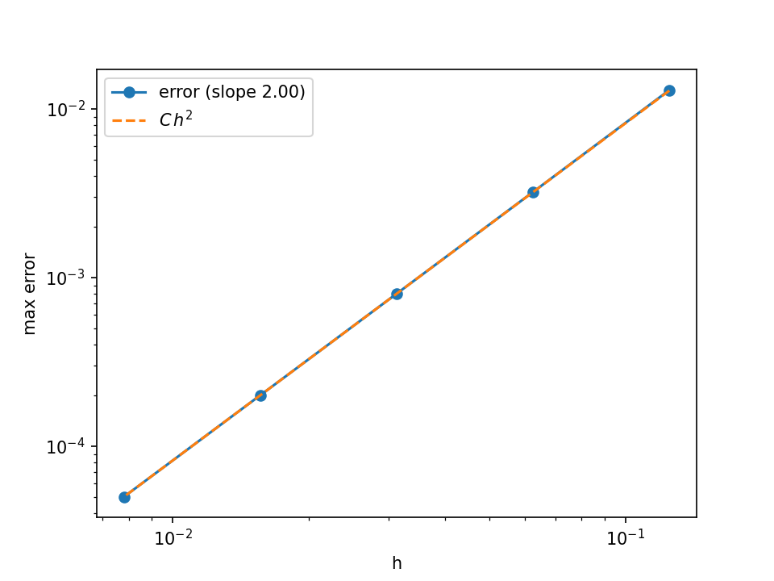
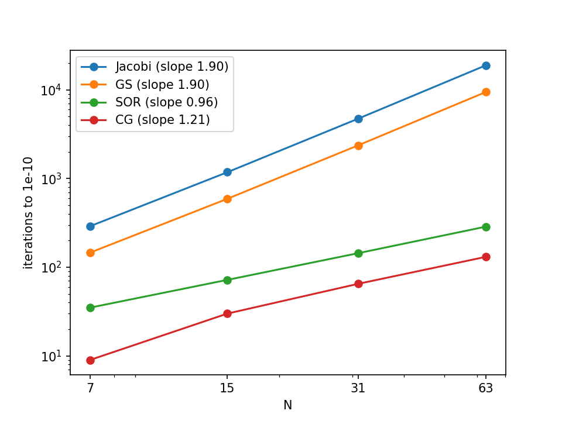
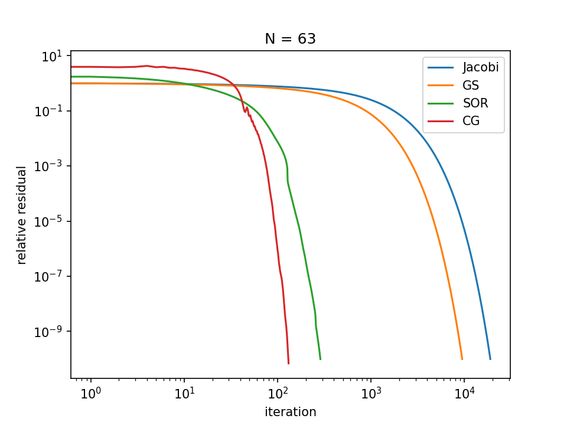
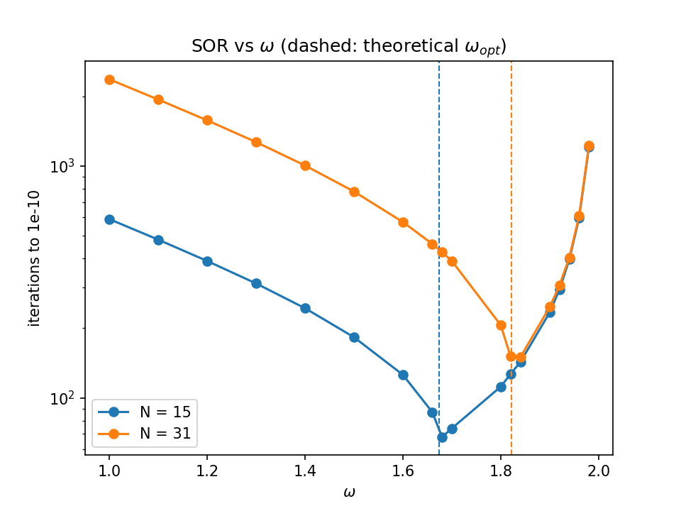

# 2D Poisson Equation: Finite-Difference Discretisation and a Theory-versus-Measurement Study of Jacobi, Gauss-Seidel, SOR and CG

Comparison of Jacobi, Gauss-Seidel, SOR and Conjugate Gradient on the 2D Poisson equation, using the 5-point finite-difference stencil. Measured iteration counts are set against the predictions of spectral theory. The derivations are in [NOTE.pdf](NOTE.pdf).


## Problem

Solve
$$-\Delta u = f \quad \text{on } (0,1)^2, \qquad u = 0 \text{ on the boundary.}$$

- **Grid:** $N \times N$ interior points, $h = 1/(N+1)$.
- **Matrix:** $A = I \otimes T + T \otimes I$ with $T = \frac{1}{h^2}\,\mathrm{tridiag}(-1, 2, -1)$. $A$ is sparse, symmetric and positive definite.
- **Test problem 1 (accuracy):** $u = \sin(\pi x)\sin(\pi y)$, $f = 2\pi^2 u$.
- **Test problem 2 (solver comparison):** $f = 1$, checked against a direct sparse solve (`scipy.sparse.linalg.spsolve`).
- **Stopping rule:** $\lVert b - Ax\rVert_2 / \lVert b\rVert_2 < \varepsilon = 10^{-10}$, starting from $x = 0$.

## Repository contents

```
poisson2d-iterative-solvers/
|-- 2d_poisson_project.ipynb
|-- NOTE.pdf
|-- poisson.py
|-- tests/
|   `-- test_solvers.py
|-- pytest.ini
|-- requirements.txt
|-- README.md
`-- results/
```

The notebook is self-contained. `poisson.py` holds the same solver code so that `pytest` can import it. `NOTE.pdf` contains the mathematical derivations.

## How to run

```bash
git clone https://github.com/<7-coffeekook>/<poisson2d-iterative-solvers>.git
cd <poisson2d-iterative-solvers>
pip install -r requirements.txt
pytest
```

Then open `2d_poisson_project.ipynb` and use **Kernel → Restart & Run All**. Numba is optional but strongly recommended: without it the loops are too slow for $N = 63$.

## Implementation notes

- **Jacobi and SOR** work directly on a padded $(N+2)\times(N+2)$ grid, so no matrix is assembled. Jacobi uses a second array so that all updates use old values; SOR updates in place. Gauss-Seidel is SOR with $\omega = 1$.
- **CG** is unpreconditioned and uses the sparse matrix $A$.
- **Optimal relaxation parameter:** $\omega_{\mathrm{opt}} = \dfrac{2}{1 + \sin(\pi h)}$.
- **Tests** (`tests/test_solvers.py`, run with `pytest`): six tests covering matrix structure, second-order discretisation error, and agreement of each solver with the direct solve to $10^{-6}$.

## Results

### 1. Discretisation error is second order

For $f = 2\pi^2\sin(\pi x)\sin(\pi y)$ the leading truncation error of the stencil is $-\frac{h^2}{12}(u_{xxxx} + u_{yyyy})$, which gives
$$\max|u_h - u| \approx \frac{\pi^2}{12}\,h^2 \approx 0.8225\,h^2 .$$
Derivation: [NOTE.pdf](NOTE.pdf), section 1.

| $N$ | max error | error $/\,h^2$ |
|---|-----------|-----------|
| 7 | 1.295e-02 | 0.8288 |
| 15 | 3.219e-03 | 0.8241 |
| 31 | 8.036e-04 | 0.8229 |
| 63 | 2.008e-04 | 0.8226 |
| 127 | 5.020e-05 | 0.8225 |

The fitted log-log slope is **2.002**.



### 2. Iterations to reach $10^{-10}$ ($f = 1$)

| $N$ | Jacobi | Gauss-Seidel | SOR ($\omega_{\mathrm{opt}}$) | CG |
|---|--------|--------------|-------------|----|
| 7 | 290 | 146 | 35 | 9 |
| 15 | 1179 | 591 | 72 | 30 |
| 31 | 4734 | 2368 | 144 | 65 |
| 63 | 18943 | 9473 | 287 | 131 |

Fitted growth $\text{iterations} \propto N^p$: Jacobi **1.90**, Gauss-Seidel **1.90**, SOR **0.96**, CG **1.21**. For CG the local slope between consecutive points is 1.74, 1.12 and 1.01 (measured against $1/h = N+1$).

The matrix has eigenvalues $\lambda_k + \lambda_l$ with $\lambda_k = \frac{4}{h^2}\sin^2\frac{k\pi h}{2}$ and condition number $\kappa = \cot^2\frac{\pi h}{2} \approx \frac{4}{\pi^2 h^2}$ ([NOTE.pdf](NOTE.pdf), section 2).





### 3. Theory versus measurement

Predicted iteration counts for tolerance $\varepsilon$:

- **Jacobi:** $k \approx \dfrac{\ln\varepsilon}{\ln\rho_J}$ with $\rho_J = \cos(\pi h)$.
- **Gauss-Seidel:** $\rho_{GS} = \rho_J^2 = \cos^2(\pi h)$.
- **SOR, simple:** $\rho_{SOR} = \omega_{\mathrm{opt}} - 1$ and $k \approx \dfrac{\ln\varepsilon}{\ln\rho_{SOR}}$.
- **SOR, refined:** the solution of $k\,\rho_{SOR}^{\,k} = \varepsilon$ (Jordan block at $\omega_{\mathrm{opt}}$).
- **CG (upper bound):** $k \approx \tfrac12\cot\!\big(\tfrac{\pi h}{2}\big)\ln\dfrac{2}{\varepsilon}$.

| $N$ | Method | Measured | Simple prediction | Measured / simple | Refined prediction | Measured / refined |
|---|--------|----------|-------------------|-------------------|--------------------|--------------------|
| 7 | Jacobi | 290 | 291 | 1.00 | - | - |
| 7 | GS | 146 | 145 | 1.00 | - | - |
| 7 | SOR | 35 | 29 | 1.23 | 33 | 1.06 |
| 7 | CG (bound) | 9 | 60 | 0.15 | - | - |
| 15 | Jacobi | 1179 | 1187 | 0.99 | - | - |
| 15 | GS | 591 | 593 | 1.00 | - | - |
| 15 | SOR | 72 | 58 | 1.24 | 69 | 1.04 |
| 15 | CG (bound) | 30 | 120 | 0.25 | - | - |
| 31 | Jacobi | 4734 | 4770 | 0.99 | - | - |
| 31 | GS | 2368 | 2385 | 0.99 | - | - |
| 31 | SOR | 144 | 117 | 1.23 | 142 | 1.01 |
| 31 | CG (bound) | 65 | 241 | 0.27 | - | - |
| 63 | Jacobi | 18943 | 19104 | 0.99 | - | - |
| 63 | GS | 9473 | 9552 | 0.99 | - | - |
| 63 | SOR | 287 | 234 | 1.22 | 292 | 0.98 |
| 63 | CG (bound) | 131 | 483 | 0.27 | - | - |

Discussion of where theory and measurement agree and where they differ: see [NOTE.pdf](NOTE.pdf), section 3.
### 4. Sensitivity of SOR to $\omega$



- The theoretical optima are $\omega_{\mathrm{opt}} = 1.674$ ($N = 15$) and $\omega_{\mathrm{opt}} = 1.822$ ($N = 31$), shown as dashed lines. The minimum of each curve lies within 0.02 of its dashed line: $N = 15$ needs 68 iterations at $\omega = 1.68$, and $N = 31$ needs 151 at $\omega = 1.82$ and 150 at $\omega = 1.84$ (144 at the exact $\omega_{\mathrm{opt}}$).
- For $\omega = 1.98$ the formula $\ln\varepsilon / \ln(\omega - 1)$ gives about 1140 iterations, against 1207 ($N = 15$) and 1225 ($N = 31$) measured.

### 5. Timing

Best of 5 runs after a Numba warm-up, on one machine; times are only indicative. The `spsolve` time includes the conversion `A.tocsc()`.

| $N$ | Jacobi | Gauss-Seidel | SOR | CG | spsolve |
|---|--------|--------------|-----|----|---------|
| 63 | 300.3 ms | 405.8 ms | 12.5 ms | 6.9 ms | 13.1 ms |

## Limitations and possible extensions

- Unpreconditioned CG only (try incomplete Cholesky or multigrid preconditioning).
- Lexicographic ordering for Gauss-Seidel and SOR (try red-black ordering).
- The $\omega$ scan is coarse (step 0.1) away from $\omega_{\mathrm{opt}}$.
- Dirichlet boundary conditions on the unit square only.

## Requirements

Python 3.9+, NumPy, SciPy, Matplotlib, Numba (optional), pytest.
